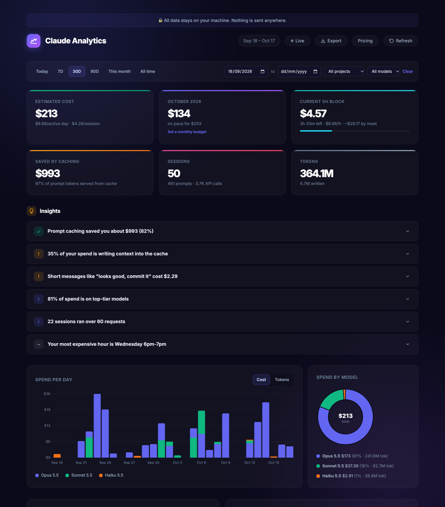
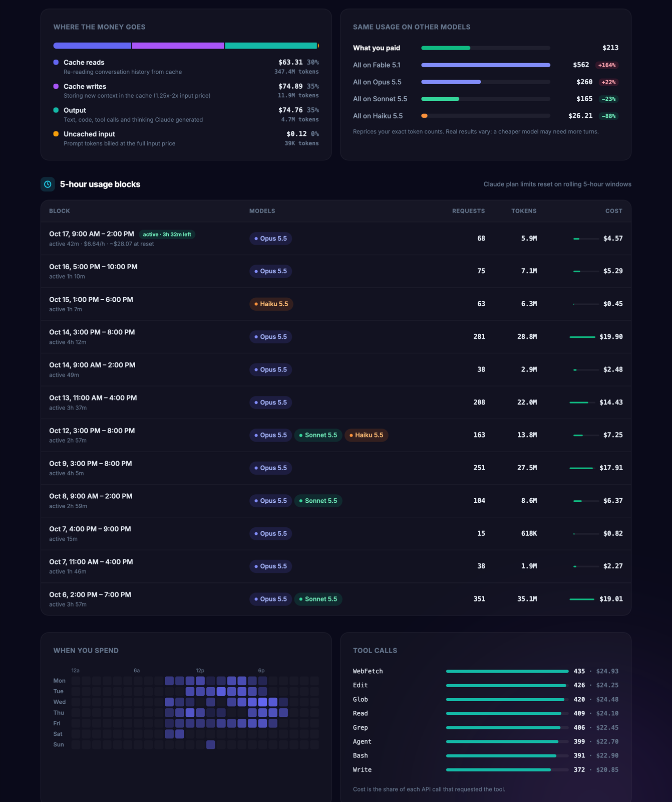
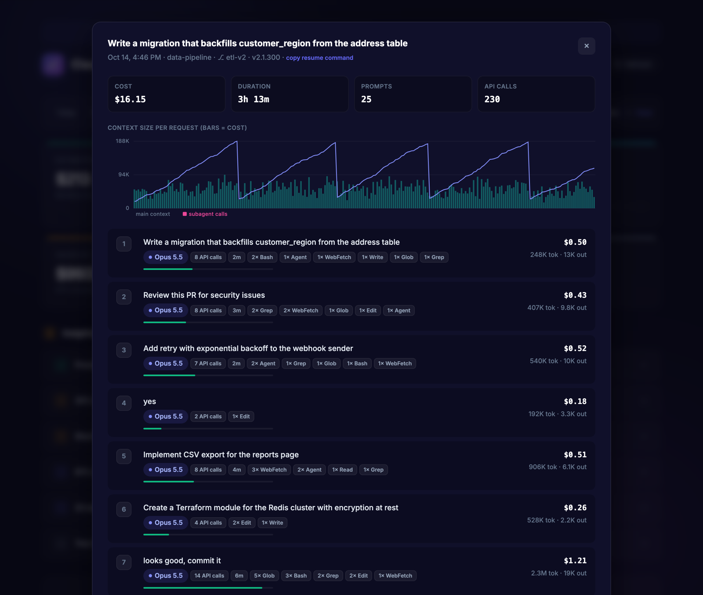

# Claude Analytics

**See where your Claude Code tokens and dollars go. One command, zero setup.**

[](https://www.npmjs.com/package/claude-code-usage-analytics)
[](LICENSE)



Claude Analytics reads your local Claude Code session data and serves an interactive dashboard showing exactly where your tokens are being consumed.

## Quick Start

```bash
npx claude-code-usage-analytics
```

That's it. Your browser opens with a full analytics dashboard.

## Features

- **Accurate costs** - Every API request is priced per token bucket: uncached input, 5-minute and 1-hour cache writes, cache reads, output (including thinking), web searches, fast mode and long-context rates. Totals are calibrated against the cost records Claude Code writes itself, so they match what `/cost` reports.
- **Filters** - Today / 7D / 30D / 90D / This month / All time, custom dates, project and model. Filters live in the URL, so a view can be bookmarked.
- **Monthly tracking** - Month-to-date spend, projected month total, comparison with last month, and an optional monthly budget with a pace marker
- **5-hour usage blocks** - The rolling windows Claude plan limits reset on, with burn rate, projected cost and time left in the current block
- **Where the money goes** - Spend split into cache reads, cache writes, output, uncached input and web search, plus how much prompt caching saved you
- **What-if pricing** - Your exact token counts repriced on Fable, Opus, Sonnet and Haiku
- **Smart insights** - Cache-write share, vague prompts, top-heavy sessions, subagent share, model mix, long sessions, thinking share, peak hour
- **Heatmap and tool calls** - When you spend (weekday × hour) and which tools drive cost
- **Session drilldown** - Per-prompt cost, a context-size chart (subagents highlighted), the cost Claude Code logged, lines changed, and a copy-paste `claude --resume` command
- **Subagents included** - Task and workflow subagent transcripts count toward their parent session
- **Exports** - Sessions, prompts or every API request as CSV, or the full report as JSON
- **Live mode** - Re-reads changed session files every 30 seconds (incremental, so it stays fast)
- **Terminal mode** - `--summary` prints a cost table; `--json` prints the full report
- **100% private** - Runs locally and binds to 127.0.0.1 by default. No data leaves your machine.

## Screenshots

**Where the money goes, what-if pricing, 5-hour blocks, heatmap and tool calls**



**Session drilldown: cost per prompt and context growth**



<sub>Screenshots use generated demo data.</sub>

## How costs are calculated

1. Claude Code streams each response into several transcript lines that share one message id. These are merged so nothing is counted twice.
2. Lines from unfinished streams carry placeholder output counts. The real output size is estimated from the content length.
3. Each request is priced with the model's rates (see `src/pricing.js`, or the **Pricing** button in the dashboard).
4. When Claude Code's own `cost-state` records exist for a session, per-model token totals are topped up to match them. This also covers background calls that never appear in the transcript.

These are API-equivalent costs. On a Pro or Max subscription you pay a flat fee, so treat the figures as the value of your usage.

## Options

```bash
npx claude-code-usage-analytics                    # Default: opens on port 3456
npx claude-code-usage-analytics --port 8080        # Custom port
npx claude-code-usage-analytics --host 0.0.0.0     # Expose on the network (default: 127.0.0.1)
npx claude-code-usage-analytics --no-open          # Don't auto-open browser
npx claude-code-usage-analytics --summary          # Terminal cost summary
npx claude-code-usage-analytics --json --days 7    # Last 7 days as JSON
npx claude-code-usage-analytics --help             # Show help
```

`CLAUDE_CONFIG_DIR` is respected if you keep Claude Code data somewhere other than `~/.claude`.

## API

| Endpoint | Description |
|----------|-------------|
| `GET /api/data?from=YYYY-MM-DD&to=&project=&model=&refresh=1` | Full report |
| `GET /api/session/:id` | Per-prompt and per-request detail for one session |
| `GET /api/export?format=csv\|json&level=sessions\|prompts\|requests` | Downloads |

## Project Structure

```
src/
├── index.js      # CLI entry point (--summary, --json, server)
├── server.js     # Express API
├── parser.js     # Transcript parsing, dedup, calibration, file cache
├── pricing.js    # Model price table and cost functions
├── report.js     # Aggregations, blocks, insights, session detail
├── export.js     # CSV export
└── public/       # Dashboard UI (vanilla JS, canvas charts)
homepage/         # Landing page (deployed on Vercel)
```

## Tech Stack

- **Backend**: Node.js, Express
- **Frontend**: Vanilla HTML/CSS/JS, Canvas charts
- **Theme**: Dark mode with glassmorphism
- **Deployment**: Vercel (landing page)

## Privacy

All data stays on your machine. The tool reads `~/.claude/` locally and serves a dashboard on localhost. Nothing is sent to any external server.

## License

MIT

## Author

Made with love by [Bishal](https://bishalde.vercel.app/)

- [LinkedIn](https://www.linkedin.com/in/bishalde/)
- [GitHub](https://github.com/bishalde)
